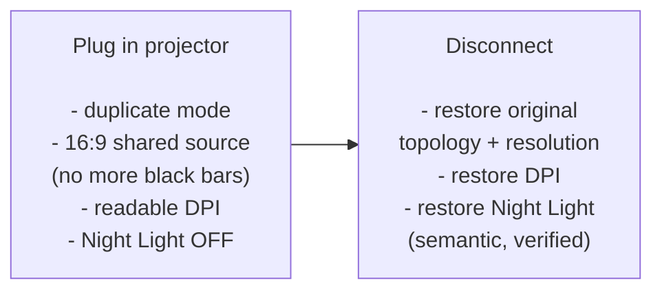
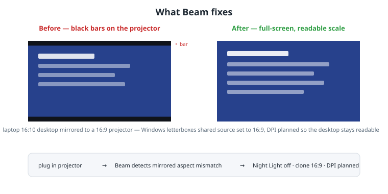
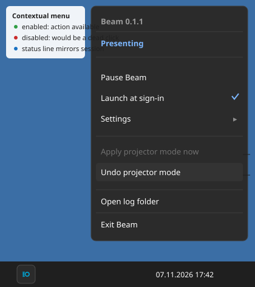
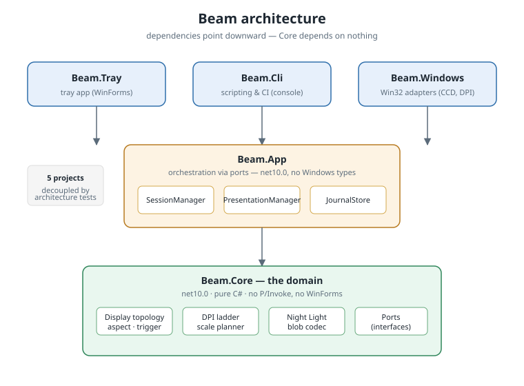
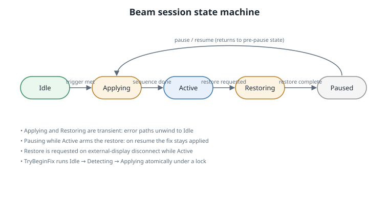

# Beam — Projector Mode for Windows

> Plug in. Look right. Every time.

[](https://github.com/patbaumgartner/beam-windows/actions/workflows/ci.yml)
[](https://github.com/patbaumgartner/beam-windows/actions/workflows/release.yml)
[](LICENSE)
[](global.json)
[](CONTRIBUTING.md)

Beam is a small, per-user Windows tray app that gives you a **presentation state** the
moment you plug in a projector: it removes the black bars, applies a readable DPI, and
temporarily turns **Night Light** off — then restores every setting **exactly** when the
projector disconnects.



<p>
  
</p>

## Why

Windows' "Duplicate" mode mirrors your laptop's *own* aspect ratio. If your panel is
16:10 and the projector is 16:9, you get black bars and tiny text every single time you
present. No built-in feature fixes this, and no mainstream Windows utility does the whole
job — detect → fix → roll back. That gap is why Beam exists (full rationale in
[docs/README.md](docs/README.md)).

## Features

- 🖥️ **Automatic trigger** — watches displays, and the moment an external 16:9 panel is
  mirrored with an aspect mismatch, Beam goes to work.
- 📐 **Best-fit 16:9** — picks the highest supported 16:9 mode the shared source actually
  supports (60 Hz preferred, 30 Hz fallback) instead of hard-coding a resolution.
- 🔍 **Readable DPI** — scales the shared source to a sane value via the same undocumented
  API the Settings app uses.
- 🌙 **Night Light awareness** — temporarily disables the *real* Windows Night Light
  (CloudStore state, verified by re-read) and restores it semantically on disconnect.
- ↩️ **Exact rollback** — restores topology, sourced resolutions, and Night Light when the
  display goes away. Safe even if Beam is killed mid-fix.
- 🖱️ **Responsive tray menu** — status, **Launch at sign-in**, Pause/Resume, *Apply
  projector mode now*, *Restore display*.
- 💠 **High-beam icon** — Pantone 638C with a halo, reads on light and dark taskbars
  (icon by I Create Stuff, CC BY 3.0 — see [assets/ATTRIBUTION.md](assets/ATTRIBUTION.md)).
- 🧰 **CLI** — `beam status`, `beam devices`, `beam apply`, `beam restore`,
  `beam dpi`, `beam nightlight` with `--json` and documented exit codes — for scripts and
  power users.
- 🔒 **No admin** — per-user install and runtime; never elevates.
- 🧪 **Tested** — 519 xUnit tests, with the application layer driven entirely through
  fake ports. Core is at ~96% line coverage and App at ~97%; see
  [test-strategy.md](docs/05-delivery/test-strategy.md) and
  [docs/06-development/testing.md](docs/06-development/testing.md).

## Quick start

### Installer (recommended)

Download the latest installer from the
[Releases](https://github.com/patbaumgartner/beam-windows/releases) page and run it.
Tick **Launch Beam at sign-in** when prompted. That's it — Beam lives in the tray.

### Build from source

[.NET 10 SDK](https://dot.net) is required (version pinned in `global.json`).

```powershell
git clone https://github.com/patbaumgartner/beam-windows.git
cd beam-windows
dotnet build Beam.sln
dotnet test Beam.sln
pwsh eng/coverage.ps1        # per-assembly coverage table
```

The suite runs on any Windows machine with the SDK; no projector is required. See
[docs/06-development/testing.md](docs/06-development/testing.md) for the test layout and
[architecture.md](docs/06-development/architecture.md) for the dependency rules.

## Usage

<p>
  
</p>

### Tray

| Menu item | What it does |
|---|---|
| **Status** | Current session state (read-only) |
| **Launch at sign-in** | Add/remove Beam from Windows startup (HKCU Run key) |
| **Pause / Resume** | Stop / restart reacting to display changes |
| **Apply projector mode now** | Manually run the fix |
| **Restore display** | Manually roll back to the previous configuration |
| **Exit Beam** | Quit |

### CLI

```text
beam status [--json]                 Current topology + what Beam would do
beam devices [--json]                Every display path, active and inactive
beam apply [--dry-run] [--json]      Run the fix (or print the plan only)
beam restore [--nightlight] [--json]  Roll back (optionally re-enable Night Light)
beam dpi read|set <percent> [--json]
beam nightlight <on|off> [--json]
```

Exit codes: `0` success · `1` failure · `2` bad arguments · `3` no projector · `4` unsupported.

```powershell
beam status --json
beam apply --dry-run
beam restore
```

## How it works

1. **Detection** — `DisplayInventory` queries `QueryDisplayConfig`. Duplicate mode is
   detected from `currentTopologyId` (`DISPLAYCONFIG_TOPOLOGY_CLONE`), the canonical signal
   on Windows 11 (see [UC-07](docs/02-use-cases/UC-07-restore-on-disconnect.md)).
2. **Fix** — `DisplayModeController` enters clone mode, then scans
   `EnumDisplaySettingsEx` for the best supported 16:9 mode. `DpiController` reads and
   sets the source's DPI scale (`DisplayConfigGetDeviceInfo(-3/-4)`).
3. **Night Light** — `NightLightController` writes the user's CloudStore state blob for the
   real Settings toggle, and re-reads it to verify.
4. **Rollback** — on disconnect (or manual restore), `SetDisplayConfig` restores the
   extended topology and each captured DEVMODE; Night Light is restored semantically.

The engine is deliberately layered:

<p>
  
</p>

| Layer | Knows about | Never references |
|---|---|---|
| `Beam.Core` | domain types, ports, logging abstraction | Windows, UI, P/Invoke |
| `Beam.App` | orchestration, journal, file logging | `Beam.Windows`, `Beam.Tray`, WinForms |
| `Beam.Windows` | Win32/WinRT adapters implementing the ports | UI |
| `Beam.Tray` / `Beam.Cli` | composition roots | — |

The presentation sequence lives in `Beam.App` and talks only to Core ports, so the whole
apply → active → disconnect → restore cycle is unit-tested with fakes — no projector, no
screen blanking. The session state machine is exhaustively matrix-tested (every state ×
every transition):

<p>
  
</p>

That split also means the pure engine can be donated to PowerToys as-is
(see [ADR-0001](docs/04-adr/ADR-0001-upstream-path.md),
[ADR-0014](docs/04-adr/ADR-0014-application-layer-and-ports.md), and
[docs/05-delivery/upstream-plan.md](docs/05-delivery/upstream-plan.md)).

## Project layout

| Path | Purpose |
|---|---|
| [`src/Beam.Core`](src/Beam.Core) | Pure domain: topology model, trigger, DPI planning, Night Light codec, ports |
| [`src/Beam.App`](src/Beam.App) | UI-free application layer: session state machine, presentation sequence, journal, file logging |
| [`src/Beam.Windows`](src/Beam.Windows) | Thin Win32/WinRT adapters that implement the Core ports |
| [`src/Beam.Tray`](src/Beam.Tray) | WinForms tray composition root (`Beam.exe`) |
| [`src/Beam.Cli`](src/Beam.Cli) | Scriptable CLI composition root (`Beam.Cli.exe`, invoked as `beam`) |
| [`tests/`](tests) | Six xUnit projects: Core, App, Windows, Tray, CLI, Architecture |
| [`eng/`](eng) | Coverage reporter/gate and Markdown link checker used by CI |
| [`spikes/`](spikes) | Numbered proof-of-concept spikes (S1–S7) |
| [`docs/`](docs) | Vision, research, use cases, arc42, ADRs, delivery and development notes |

## Building the installer locally

Requires [Inno Setup 6](https://jrsoftware.org/isinfo.php) (or `winget install
JRSoftware.InnoSetup`).

```powershell
.\installer\build.ps1                 # publish + compile to .\artifacts
.\installer\build.ps1 -Version 0.2.0  # tag a different version
```

CI builds a snapshot installer on every push to `main` and a release installer for every
`v*` tag — no local tooling needed.

## Quality gates

Every pull request runs the same gates locally and in CI:

| Gate | Command | Bar |
|---|---|---|
| Build | `dotnet build Beam.sln -c Release` | zero warnings (warnings are errors) |
| Formatting | `dotnet format Beam.sln --verify-no-changes` | clean |
| Tests | `dotnet test Beam.sln -c Release` | 519 pass, no hardware required |
| Architecture | `Beam.Architecture.Tests` | project-reference rules and no UI/P/Invoke in portable layers |
| Coverage | `pwsh eng/coverage.ps1 -NoTest -Enforce` | Core ≥ 85%, App ≥ 80%, CLI ≥ 75% |
| Docs | `pwsh eng/check-links.ps1` | every relative Markdown link resolves |

Windows and Tray coverage is reported for visibility but not gated: those assemblies are
thin OS adapters whose meaningful paths need a real graphics stack and are verified manually
against the hardware matrix in [test-strategy.md](docs/05-delivery/test-strategy.md).

## Roadmap & status

Phase 0–5 milestones are tracked in [docs/05-delivery/roadmap.md](docs/05-delivery/roadmap.md).
Current status: **tray MVP shipped**, CLI shipped, installer + CI shipping. The long-term
goal remains donating the engine to [PowerToys PowerDisplay](docs/01-research/powertoys-landscape.md).

## Contributing

See [CONTRIBUTING.md](CONTRIBUTING.md). This project follows the
[Contributor Covenant](CODE_OF_CONDUCT.md); security issues go through
[SECURITY.md](SECURITY.md).

## License

[MIT](LICENSE) © 2026 Patrick Baumgartner — MIT was chosen for friction-free donation to
PowerToys (see [ADR-0012](docs/04-adr/ADR-0012-license.md)).
